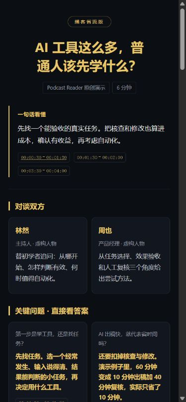
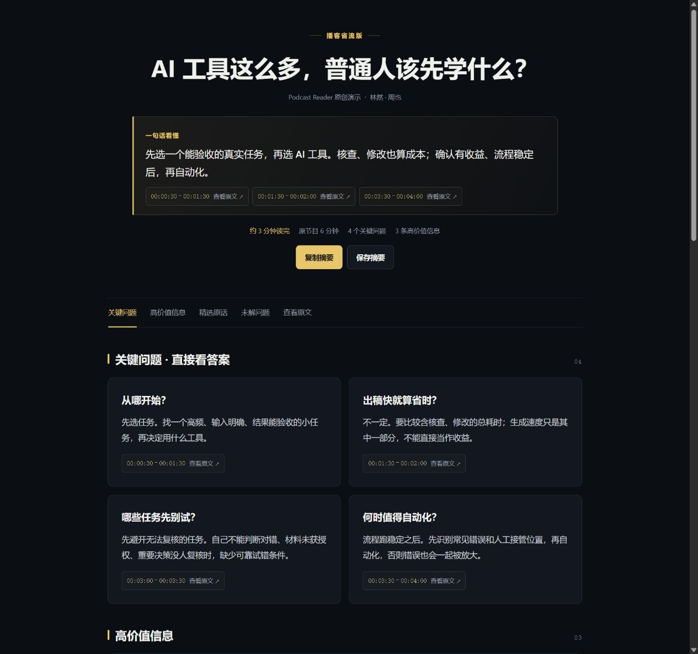
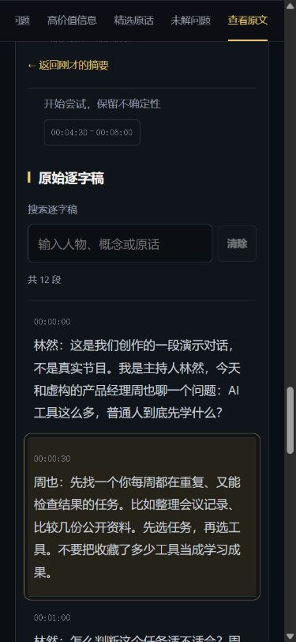
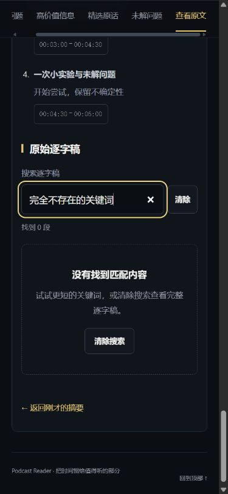

# 省流阅读体验审查与改版

2026-10-20 · 目标：让第一次打开的人迅速抓住关键问题和高价值信息，能核对依据，也能带走总结。

本轮使用项目自编的虚构节目演示，实际操作本地阅读页，并检查生成、缓存和分享流程。以下结论来自界面审查和功能验证，没有进行真实用户访谈，也不代表所有来源平台已经实测。

## 1. 打开页面，先知道值不值得读

**原问题：** 人物介绍占据前排；原节目时长没有明确标签；问题字号和对比度偏低，答案却大面积加粗着色。手机双列卡片使每行文字过短。

**已改：** 首屏为标题、一句话结论、估算阅读时长、原节目时长、真实问题/洞察数量。关键问题直接接在首屏后，人物与来源作为补充放到后面。保留黑金方向，建立标题、问题、答案、引用四层清晰层级。

| 改版前：手机 | 改版后：手机 |
|---|---|
|  |  |

手机正文 16px、问题 18px，600px 以下使用单列。320px 与 390px 窄屏检查均无页面横向溢出；主要按钮和手机引用入口高 44px。首屏依据采用紧凑入口，完整时间范围仍保留在可访问名称中。

## 2. 快速扫读，内容各司其职

**原问题：** 问答与洞察重复同一建议，信息虽然齐全，却不够省时间。

**已改：** 问答负责直接判断，洞察补充原因、计算、方法和适用例外。按价值排序，关键限制紧跟相关结论。示例从 6 个问题、5 条洞察整理为 4 个问题、3 条洞察；问答文字从 327 字降至 189 字，没有新增事实或依据。

生成规范同时更新：提炼具体问题、先给直接答案、跨栏目去重；中英文篇幅目标为软约束，短节目不凑数。Markdown 与网页保持内容优先的阅读顺序。

吸顶目录只列出实际存在的内容，标记当前阅读位置；手机目录可横向滚动。正文不依赖外部字体、脚本或服务。



## 3. 查依据后，能回到刚才的位置

**原问题：** 点击引用进入长原文后难以返回；搜索无结果只留下空白区域。

**已改：** 原文默认折叠。点击本地引用会展开、清除旧过滤条件、定位并突出对应段落。返回入口固定在目录下方，返回时恢复刚才引用的键盘焦点。没有真实时间轴时继续使用段落编号。

支持回听定位的平台保留时间链接；其他来源提供原节目链接与本地原文定位，不制造不支持的跳转参数。

| 原文定位与固定返回入口 | 无结果时给出恢复路径 |
|---|---|
|  |  |

## 4. 带走总结，确保拿到的是正确版本

**已改：** 页面可复制摘要、下载 UTF-8 Markdown。内容来自同一份规范摘要，不夹带完整逐字稿。自动复制被浏览器拒绝时，展示已选中的文字供手动复制；未完成摘要不提供可用的复制/保存按钮。

同时修复交付路径中发现的问题：

- 分享脱敏误把 `https://` 当成本地路径，破坏外链和回听定位。
- 脱敏破坏隐藏 Markdown 中的链接，或把已转义内容恢复成活动 HTML。
- 总结尚未完成、语言已切换或文件已过期时，仍可导出旧结果。
- 复用同一输出目录或切换 RSS 集数时，残留上一来源信息或缓存。

分享和可移植导出现在先检查完成状态与文件一致性，脱敏后重新计算文件校验值；备份归档仍允许保存进行中的工作。

## 验证记录

- 实际浏览器操作：复制结果与规范摘要一致；下载文件去除 BOM、统一换行后与规范摘要一致。
- 模拟剪贴板拒绝：显示手动复制区域，文本全选且焦点正确；验证后恢复正常页面。
- 点击引用、返回原位置、直接打开段落锚点、搜索零结果、一键恢复 12 段原文均通过。
- 320px、390px 手机和 1280px 桌面布局检查通过；键盘焦点可见。
- 减少动画偏好使用无平滑滚动；打印使用白底，并隐藏工具栏、目录和原文。已恢复测试时的媒体与视口设置。
- **110 项 Python 回归全部通过**，覆盖内容结构、引用范围、转义、未完成状态、缓存来源和分享结果；执行命令：

  ```bash
  python -m unittest discover -s podcast-reader/tests -v
  python -m compileall -q podcast-reader/scripts
  python podcast-reader/scripts/release_check.py
  ```

审查前后的原始截图保留在开发工作区的 `output/playwright/ux-audit/`；上方图片为其中选取的实际界面截图。
